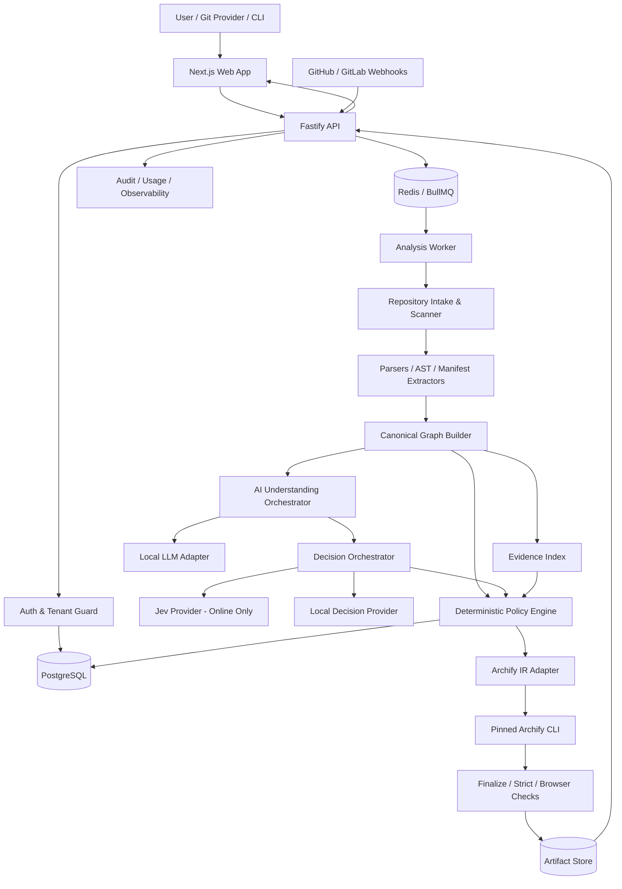

# Archify Intelligence — Production Implementation Master Plan

**Project:** Archify Intelligence  
**Product:** Complete Archify + Jev combined platform  
**Execution model:** Hybrid — online Jev + offline local AI  
**Delivery target:** Production-ready platform  
**Document status:** Implementation blueprint / source of truth for engineering agents  
**Research baseline:** 18 November 2026  

> **Core proposition:** Understand a repository with an AI agent, make narrowly scoped judgments with Jev or a local model, enforce decisions with deterministic policy code, and publish verifiable interactive architecture artifacts through Archify.

---

## 0. Executive decision

Build a modular, multi-tenant architecture-intelligence platform. Do **not** fork Archify's renderer as the first step and do **not** treat Jev as an LLM, policy engine, security scanner, or locally deployable model.

The platform has five distinct responsibilities:

1. **Repository Intelligence** discovers source structure, dependencies, Git history, APIs, data models, and evidence.
2. **AI Understanding** (remote or local LLM agent) interprets repository facts and proposes a canonical architecture graph.
3. **Decision Intelligence** uses Jev online when permitted, a local-model adapter when offline, and deterministic rules for hard facts and fail-safe behavior.
4. **Policy Engine** combines evidence and decision results into explicit outcomes such as `pass`, `review_required`, `blocked`, or `inconclusive`.
5. **Archify Adapter** maps the canonical graph into supported Archify JSON IR, invokes Archify's CLI, validates the result, and stores immutable HTML/export artifacts with provenance.

### Non-negotiable design rules

- Archify is a **visualization and validation engine**, not the platform's source of truth.
- Jev is an **online structured-judgment provider**. No assumption is made that Jev weights can be downloaded or run offline.
- Offline mode uses an independently configured local model (for example, a local OpenAI-compatible inference endpoint or Ollama adapter). Its scores and confidence must not be treated as statistically interchangeable with Jev outputs.
- Security decisions, permission checks, threshold aggregation, and approval gates are deterministic application code.
- Model outputs are advisory signals, never sufficient authority to merge code, execute commands, approve deployments, or bypass a security control.
- Repository evidence must be pinned to an exact commit and validated file/line ranges where possible.
- Preserve Archify's strict schema. Store intelligence annotations in a separate versioned sidecar and link them to stable graph node/edge IDs.
- Build against a pinned Archify commit/version. Never silently consume an unpinned `main` branch in production.
- Any uncertain or unavailable result fails safely to `inconclusive` or `review_required`, never to automatic approval.

## 1. Verified upstream constraints and integration contract

This plan uses the upstream documentation checked on 18 November 2026. Re-check upstream release notes and schemas during implementation before pinning dependencies.

### 1.1 Archify

The current repository documentation describes Archify as an agent skill plus a Node.js rendering/validation system. Agents author typed JSON IR; the CLI validates and renders standalone HTML/SVG artifacts. The documented current skill version is 3.2.0 and the skill declares Apache-2.0. The repository also contains root license files and a NOTICE/third-party notices, so legal review must preserve the applicable notices for every vendored file.

Documented diagram types:

- `architecture`
- `workflow`
- `sequence`
- `dataflow`
- `lifecycle`
- `erd`
- `class`
- `tree`
- `timeline`
- `waterfall`

The current documented command for a repository-backed diagram is:

```bash
node bin/archify.mjs finalize <type> <candidate.json> <output.html> \
  --repo-root <repository-path> --quality showcase --json
```

A successful `finalize` receipt is documented as covering validation, delivery, strict checking, and real-browser checking. For repository-backed artifacts, use `--repo-root` and source evidence only where the analyzer can establish it. Archify's output should be treated as an artifact, not as proof that a running production system behaves as drawn.

**Integration choice:** vendor Archify at a pinned Git commit (submodule, subtree, or reproducible source checkout) and invoke its CLI through a narrow `ArchifyRenderer` adapter. Avoid importing undocumented internal renderer modules. Maintain a compatibility test against the pinned CLI and schemas. Upgrade only through a reviewed dependency-update PR.

### 1.2 Jev / TypeSafe System One

The TypeSafe API documentation describes the System One endpoint as:

```http
POST https://api.typesafe.ai/v1/systemone
Authorization: Bearer <API_KEY>
Content-Type: application/json
```

The request contains `model`, `state`, and a named `questions` map. Supported question types include:

- `choice`: select from a developer-defined option map; returns a choice, probabilities, and confidence.
- `score`: evaluate against an ordered rubric; returns a score, probabilities, legend, and confidence.
- `noul`: estimate whether a statement is true; returns a value from 0 to 1. Do not assume it returns a confidence field.
- `box`: image localization; requires an experimental image header. Excluded from the production baseline until separately validated.

Several named questions can be sent in one request and are evaluated independently against the same state. The response contains the actual model ID returned, named answers, and token usage. Log the actual returned model ID, not just the alias requested.

The documented request rules include a 32 MiB body limit, UTF-8 JSON, a 64-level nesting limit, finite numbers only, and one supported compression layer. Documented error classes include 400, 401, 413, 415, 422, 429, and 529. Retry 429/529 with exponential backoff and jitter; do not retry malformed/authentication/validation errors unchanged.

**Integration choice:** implement a `DecisionProvider` port with a `JevProvider` adapter that uses the official TypeSafe endpoint or supported official SDK. Keep endpoint, model alias/version, timeouts, retry policy, and organization limits configurable. Pin a model version for controlled production releases after verifying the currently supported version; allow `jev-latest` only as an explicit opt-in with evaluation/rollout safeguards.

### 1.3 Local AI and the hybrid boundary

There is no claim in the upstream documentation used here that Jev itself can be self-hosted. Offline mode therefore means:

- repository parsing and graph construction run locally;
- the reasoning agent can use a local LLM;
- the decision provider switches to a local model adapter;
- deterministic rules continue to run without any model;
- no source content is sent to TypeSafe while `local-only` is active.

The provider used for every assessment must be recorded. Local-model calibration is an independent workstream; do not copy Jev thresholds into local mode.

## 2. Product scope

### 2.1 Product capabilities

**A. Repository intelligence**

- Connect GitHub/GitLab or scan a local Git repository.
- Inspect repository metadata, commit history, directory structure, dependency manifests, imports, API routes, database schemas, and selected source files.
- Use language-aware parsing where supported; preserve `unknown` rather than inventing missing relationships.
- Generate a canonical repository snapshot with exact commit provenance.

**B. Architecture generation**

- Generate architecture, workflow, sequence, dataflow, lifecycle, ERD, class, tree, timeline, and waterfall artifacts when the underlying evidence supports them.
- Map the canonical graph to Archify's native JSON schema.
- Validate and render through the pinned Archify CLI.
- Preserve stable node/edge IDs across scans when the entity identity remains the same.

**C. Judgment and risk signals**

- Classify change type and component role with `choice`.
- Assess defined rubric dimensions with `score`.
- Ask bounded factual/semantic questions with `noul`.
- Keep model-generated findings separate from static analysis findings.
- Compare remote and local judgments only through evaluation reports, not by assuming equivalent scores.

**D. Policy and approvals**

- Apply deterministic rules to combine static evidence, model signals, confidence availability, provider, policy version, and user-defined risk tolerance.
- Support `pass`, `review_required`, `blocked`, and `inconclusive`.
- Require an authenticated human approval for configured high-impact actions.
- Do not execute repository code or apply patches as a side effect of analysis.

**E. Change intelligence**

- Compare a base snapshot with a proposed commit.
- Show added, removed, changed, moved, and rerouted graph facts only when supported by the snapshots.
- Explain affected components with source evidence and analysis provenance.
- Generate a validated Before / Delta / After artifact.

**F. Reporting and exploration**

- Interactive standalone HTML diagrams.
- Evidence explorer and node/edge details.
- Run summaries, policy decisions, model usage, artifact manifests, and downloadable reports.
- Stable artifact URLs with access control and content hashes.

### 2.2 Explicit non-goals for the first production release

- Training a new foundation model or fine-tuning Jev.
- Claiming Jev is available offline.
- General-purpose WYSIWYG diagram editing.
- Replacing Archify's renderer or silently changing its schemas.
- Automatic code modification, merge, release, or production deployment.
- Treating generated architecture as runtime observability or proof of actual deployed topology.
- Using the experimental Jev Box/image capability as a critical production dependency.
- Automatically executing build scripts, package lifecycle hooks, tests, or arbitrary repository commands outside an isolated execution sandbox.

## 3. Functional requirements and user journeys

### 3.1 New repository scan

1. User creates a project and connects a repository or selects a local repository.
2. API verifies organization permissions and repository identity.
3. Worker checks out the requested commit in an isolated workspace.
4. Scanner inventories files and manifests while excluding secrets, generated directories, binaries, and configured paths.
5. Parser extracts facts and evidence references.
6. Graph builder creates a canonical graph and confidence/provenance metadata.
7. AI understanding agent proposes missing semantic descriptions; it cannot overwrite verified facts without explicit provenance.
8. Decision orchestrator selects Jev or local mode based on privacy and connectivity policy.
9. Policy engine evaluates deterministic findings and model signals.
10. Archify adapter generates one or more IR candidates, runs `finalize`, and records the receipts.
11. API publishes the run result and artifacts.

### 3.2 Pull request / change analysis

1. Receive a signed Git provider webhook or a manually submitted base/head commit pair.
2. Verify the webhook signature and repository identity.
3. Scan the head commit and reuse verified base snapshot data where possible.
4. Build a graph delta from canonical graph IDs, not from visual coordinates.
5. Analyze changed components, reverse dependencies, exposed interfaces, and selected security boundaries.
6. Ask Jev/local model bounded questions about each change group.
7. Evaluate configured policy rules and create a review request when necessary.
8. Render Before / Delta / After diagrams and a written assessment report.
9. Never approve or merge the PR automatically in the baseline product.

### 3.3 Offline operation

- `local-only` mode is a hard egress policy, not merely a UI preference.
- Disable Jev client calls and prevent any code path from serializing repository content to a remote provider.
- Use local model endpoint only if configured and reachable.
- If local inference is unavailable, continue deterministic checks and mark model-dependent dimensions `unavailable`; final policy may be `inconclusive` or `review_required`.
- Queue remote-only tasks only when the user explicitly permits later processing; never silently upload a repository after connectivity returns.

## 4. Target system architecture

### 4.1 Logical architecture



### 4.2 Deployment architecture

Start with a **modular monolith plus separate worker processes**, not premature microservices.

- `web`: Next.js application.
- `api`: Fastify REST API, auth, tenant authorization, project/run/artifact endpoints.
- `worker`: BullMQ workers for scan, analyze, judge, render, and export tasks.
- `postgres`: primary relational store.
- `redis`: queue, rate limits, short-lived cache, job locks.
- `object storage`: S3-compatible store for artifacts, snapshots, and retained evidence payloads where policy allows.
- `local-inference`: optional local endpoint accessible only within the deployment network or developer machine.
- `archify-runtime`: pinned Archify checkout and CLI bundled into the worker image.

Split services only when measured scale, trust boundary, or operational ownership requires it. The API must not synchronously execute long repository scans or model calls.

### 4.3 Trust boundaries

1. Browser ↔ API: authenticated HTTPS, CSRF protection for cookie auth, strict CORS.
2. API ↔ worker: signed job payloads, service identity, queue access controls.
3. Worker ↔ source repository: isolated read-only checkout, scoped Git token, no inherited host credentials.
4. Worker ↔ Jev: outbound HTTPS only when `remote_allowed=true`, data minimized and redacted.
5. Worker ↔ local model: private network or loopback endpoint; never publicly exposed by default.
6. Artifact viewer ↔ generated HTML: isolated sandboxed origin/iframe; never share app cookies or privileged origin with generated HTML.
7. Worker ↔ code execution sandbox: separate container/VM with no Docker socket, no credentials, bounded CPU/memory/time, and disabled network by default.

## 5. Core runtime modes and provider routing

### 5.1 Execution policy

| Mode | Jev | Local model | Deterministic rules | Egress |
|---|---|---|---|---|
| `remote-only` | Enabled | Optional | Always | Approved TypeSafe endpoint only |
| `local-only` | Disabled | Enabled if configured | Always | No model/content egress |
| `hybrid` | Preferred only when data is allowed and healthy | Fallback or privacy-selected path | Always | Allowlisted destinations only |
| `rules-only` | Disabled | Disabled | Always | No model egress |

Hybrid provider selection must be explicit and inspectable. Store the route reason (privacy, user setting, provider outage, or fallback) in the run record.

### 5.2 Provider policy algorithm

```text
if project.mode == local-only or data_classification >= restricted:
    use local provider if available
    otherwise run deterministic checks and mark model judgments unavailable
else if project.mode == remote-only:
    call Jev; on retry exhaustion return provider_unavailable
else if project.mode == hybrid:
    if remote_allowed and Jev circuit is healthy:
        call Jev
    else if local model is available:
        call local model
    else:
        run deterministic checks and mark result inconclusive
```

Do not automatically switch from local-only to Jev. A remote outage must not cause a fallback that violates privacy settings.

### 5.3 Decision provider contract

```ts
export type ProviderKind = "jev" | "local-model" | "rules";
export type QuestionKind = "choice" | "score" | "noul";

export interface DecisionRequest {
  requestId: string;
  state: Record<string, unknown>;
  questions: Array<{
    key: string;
    kind: QuestionKind;
    instructions: string;
    criteria?: Record<string, string> | string[];
  }>;
  policyVersion: string;
  dataClassification: "public" | "internal" | "confidential" | "restricted";
}

export interface DecisionAnswer {
  key: string;
  kind: QuestionKind;
  value: string | number;
  probabilities?: Record<string, number>;
  confidence: number | null; // null is required where the provider/type supplies no confidence, e.g. Jev Noul
  provider: ProviderKind;
  modelId: string;
  rawAnswerHash: string;
}

export interface DecisionBatch {
  requestId: string;
  provider: ProviderKind;
  modelId: string;
  answers: DecisionAnswer[];
  usage?: { inputTokens?: number; outputTokens?: number };
  latencyMs: number;
  observedAt: string;
}

export interface DecisionProvider {
  assess(request: DecisionRequest, signal?: AbortSignal): Promise<DecisionBatch>;
  health(): Promise<{ available: boolean; provider: ProviderKind; checkedAt: string }>;
}
```

Contract rules:

- Preserve raw provider payload only when retention policy allows; otherwise store a hash and normalized answer.
- `confidence` is nullable. Never synthesize a confidence value for Jev Noul.
- Store provider/model/version per answer batch.
- Validate probability distributions, answer keys, and answer types before policy evaluation.
- The local provider must return `calibrationStatus: "uncalibrated"` until validated on the platform's own dataset.
- The rules provider returns deterministic findings, not fabricated model probabilities.

### 5.4 Jev request example

This is an adapter-level example; exact model identifier must be configured and checked against the official model list during release qualification.

```json
{
  "model": "jev-latest",
  "state": {
    "change_summary": "A PR updates permission.guard.ts and auth.service.ts",
    "changed_files": [
      "apps/api/auth/permission.guard.ts",
      "apps/api/auth/auth.service.ts"
    ],
    "verified_facts": [
      "permission.guard.ts is imported by the protected route module",
      "auth.service.ts contains the authorization decision boundary"
    ],
    "diff_excerpt": "<redacted, bounded diff excerpt>"
  },
  "questions": {
    "change_category": {
      "type": "choice",
      "instructions": "Classify the primary engineering intent of this change.",
      "criteria": {
        "security": "Changes authentication, authorization, permissions, or trust boundaries",
        "bugfix": "Corrects an existing defect",
        "refactor": "Changes internal structure without intended behavior change",
        "feature": "Adds user-visible or system capability",
        "performance": "Primarily changes latency, throughput, or resource use",
        "other": "Does not fit the other categories"
      }
    },
    "impact_level": {
      "type": "score",
      "instructions": "Rate the potential impact if this change is incorrect.",
      "criteria": ["Low", "Moderate", "High", "Critical"]
    },
    "touches_authorization_boundary": {
      "type": "noul",
      "instructions": "Does the supplied evidence indicate that this change modifies an authorization boundary?"
    }
  }
}
```

Never send a full repository by default. Send only an approved, redacted, bounded evidence bundle. Respect TypeSafe's documented body/request constraints and split work into smaller requests when required.

## 6. Canonical domain model and JSON schemas

### 6.1 Canonical architecture graph

The platform's source of truth is a versioned graph independent of Archify.

```ts
export interface CanonicalGraph {
  schemaVersion: "1.0";
  projectId: string;
  repositoryId: string;
  snapshotId: string;
  commitSha: string;
  generatedAt: string;
  nodes: GraphNode[];
  edges: GraphEdge[];
  evidence: EvidenceRef[];
  unknowns: string[];
}

export interface GraphNode {
  id: string; // stable platform ID, not a visual coordinate
  kind: "frontend" | "backend" | "database" | "cloud" | "security" | "messagebus" | "external" | "library" | "worker" | "unknown";
  name: string;
  description?: string;
  path?: string;
  tags: string[];
  evidenceIds: string[];
  provenance: "static" | "agent-inferred" | "user-authored" | "imported";
  confidenceBand?: "verified" | "supported" | "tentative";
}

export interface GraphEdge {
  id: string;
  from: string;
  to: string;
  relation: "calls" | "imports" | "reads" | "writes" | "publishes" | "subscribes" | "authenticates" | "authorizes" | "deploys" | "depends-on" | "unknown";
  description?: string;
  evidenceIds: string[];
  provenance: "static" | "agent-inferred" | "user-authored" | "imported";
}

export interface EvidenceRef {
  id: string;
  repositoryId: string;
  commitSha: string;
  path: string;
  startLine?: number;
  endLine?: number;
  blobSha?: string;
  evidenceType: "source" | "manifest" | "schema" | "config" | "git-diff" | "test" | "documentation";
  excerptHash: string;
  redactionApplied: boolean;
}
```

### 6.2 Intelligence sidecar

Keep this separate from Archify IR because Archify validates strict schemas and unknown fields must not be added casually.

```json
{
  "schemaVersion": "1.0",
  "snapshotId": "snap_01J...",
  "providerContext": {
    "mode": "hybrid",
    "provider": "jev",
    "modelId": "jev-1.x.y",
    "calibrationStatus": "provider-calibrated",
    "policyVersion": "risk-policy-1.0.0"
  },
  "nodeAssessments": [
    {
      "nodeId": "auth.permission-guard",
      "riskBand": "high",
      "assessmentIds": ["assess_01J..."],
      "evidenceIds": ["ev_01J..."]
    }
  ],
  "edgeAssessments": [],
  "limitations": ["Static source scan only; no runtime topology was observed"]
}
```

### 6.3 Policy decision

```ts
export type PolicyOutcome = "pass" | "review_required" | "blocked" | "inconclusive";

export interface PolicyDecision {
  id: string;
  runId: string;
  outcome: PolicyOutcome;
  policyVersion: string;
  ruleIds: string[];
  reasons: Array<{
    code: string;
    severity: "info" | "low" | "medium" | "high" | "critical";
    message: string;
    evidenceIds: string[];
    assessmentIds: string[];
  }>;
  requiresHumanApproval: boolean;
  decidedAt: string;
}
```

### 6.4 Archify mapping

- Map canonical node IDs to Archify component/node IDs using deterministic ID mapping.
- Select diagram type from the user's question and graph shape; do not force every graph into every type.
- Build the candidate using the exact upstream schema and examples for the pinned Archify commit.
- Attach verified repository source references using Archify's documented repository-evidence contract and `--repo-root`.
- Put risk labels, assessment summaries, and policy details in a sidecar and first-party platform UI. Only write into Archify fields explicitly supported by the pinned schema.
- Preserve the candidate JSON, final HTML, finalize receipt, renderer version/commit, source commit, and content hashes.

## 7. Repository analysis pipeline

### 7.1 Pipeline stages

1. `repository.resolve`: verify source identity and requested ref.
2. `repository.checkout`: create an immutable, isolated worktree at the exact commit.
3. `inventory.scan`: enumerate files under allowlisted root; exclude `.git`, build output, vendored binaries, secrets, generated files, and ignored paths.
4. `secrets.scan`: detect and redact likely credentials before any model use.
5. `manifest.extract`: parse package manifests, lockfiles, Docker files, CI, IaC, ORM and API schema files.
6. `language.parse`: parse supported languages (initially TypeScript/JavaScript, Python, Rust, and Go after per-language tests); use graceful unknown fallbacks.
7. `symbol.index`: identify modules, functions, classes, exports and route handlers.
8. `dependency.resolve`: construct import/package relationships with source evidence.
9. `api.extract`: identify HTTP routes, RPC contracts, event topics, auth guards and data stores where statically visible.
10. `graph.build`: canonical graph and stable IDs.
11. `agent.enrich`: ask the local/remote reasoning agent for bounded semantic labels, explanations and candidate relationships; preserve provenance.
12. `decision.assess`: run Jev/local judgment questions.
13. `policy.evaluate`: produce outcome and reasons.
14. `archify.author`: map to the appropriate native IR.
15. `archify.finalize`: validate/render/check in a bounded worker.
16. `artifact.publish`: immutable artifact manifest and authorized URL.
17. `audit.close`: record versions, timings, token usage, policy, evidence and status.

### 7.2 Supported analysis levels

- **L0 Inventory:** files, language counts, manifests, dependencies.
- **L1 Static graph:** imports, packages, routes, schemas, direct calls when extractable.
- **L2 Semantic architecture:** AI-enriched component purposes and inferred cross-cutting concerns.
- **L3 Change impact:** compare base/head graph, affected neighborhoods, risk assessments.
- **L4 Evidence-backed audit:** policy, tests, verified repository evidence and complete provenance.

The UI must show the analysis level. Do not label an L1/L2 static/semantic graph as runtime-verified architecture.

## 8. API design

All endpoints are versioned under `/api/v1`. Use OpenAPI 3.1 generated from the route contracts. All responses include `requestId`; error payloads use a stable `code`, safe `message`, optional `details`, and `retryable` boolean.

### 8.1 Project and repository APIs

| Method | Path | Purpose |
|---|---|---|
| `POST` | `/api/v1/projects` | Create project |
| `GET` | `/api/v1/projects` | List tenant projects |
| `GET` | `/api/v1/projects/:projectId` | Project details |
| `PATCH` | `/api/v1/projects/:projectId` | Update settings/mode |
| `POST` | `/api/v1/projects/:projectId/repositories` | Connect repository |
| `GET` | `/api/v1/projects/:projectId/repositories` | List connected repositories |
| `DELETE` | `/api/v1/projects/:projectId/repositories/:repositoryId` | Disconnect repository |

### 8.2 Analysis APIs

| Method | Path | Purpose |
|---|---|---|
| `POST` | `/api/v1/projects/:projectId/runs` | Start snapshot or change analysis |
| `GET` | `/api/v1/runs/:runId` | Run status and summary |
| `GET` | `/api/v1/runs/:runId/events` | SSE progress events |
| `GET` | `/api/v1/runs/:runId/graph` | Canonical graph (authorized) |
| `GET` | `/api/v1/runs/:runId/assessments` | Decision assessments |
| `GET` | `/api/v1/runs/:runId/policy` | Policy outcome and reasons |
| `POST` | `/api/v1/runs/:runId/render` | Re-render from a frozen graph |
| `POST` | `/api/v1/runs/:runId/compare` | Compare two snapshots |
| `POST` | `/api/v1/runs/:runId/approvals` | Submit an authorized human review decision |

### 8.3 Artifact APIs

| Method | Path | Purpose |
|---|---|---|
| `GET` | `/api/v1/runs/:runId/artifacts` | List artifacts |
| `GET` | `/api/v1/artifacts/:artifactId` | Artifact manifest and metadata |
| `GET` | `/api/v1/artifacts/:artifactId/content` | Authorized content/download route |
| `POST` | `/api/v1/artifacts/:artifactId/revoke` | Revoke shared access |

### 8.4 Provider and settings APIs

| Method | Path | Purpose |
|---|---|---|
| `GET` | `/api/v1/settings/providers` | Provider status/configuration (never return secrets) |
| `PATCH` | `/api/v1/settings/providers` | Update mode and safe configuration |
| `POST` | `/api/v1/settings/providers/jev/test` | Test Jev connection without repository content |
| `POST` | `/api/v1/settings/providers/local/test` | Test local model endpoint |
| `GET` | `/api/v1/settings/policies` | List policy versions |
| `POST` | `/api/v1/settings/policies` | Create a policy version |

### 8.5 Webhooks

- `POST /api/v1/webhooks/github`
- `POST /api/v1/webhooks/gitlab`

Validate the provider signature before enqueueing. Deduplicate deliveries by provider delivery ID. Webhook handlers must be short and idempotent.

### 8.6 Start-run request example

```json
{
  "repositoryId": "repo_01J...",
  "headCommit": "<full-git-sha>",
  "baseCommit": "<optional-full-git-sha>",
  "analysisLevel": "L3",
  "providerMode": "hybrid",
  "dataClassification": "confidential",
  "diagramTypes": ["architecture", "workflow", "sequence"],
  "includeSourceEvidence": true,
  "redactionProfile": "strict-default",
  "policyVersion": "risk-policy-1.0.0"
}
```

### 8.7 Run event names

`run.queued`, `repository.checked_out`, `inventory.completed`, `secrets.redacted`, `graph.built`, `agent.enrichment.completed`, `decision.assessment.completed`, `policy.evaluated`, `archify.finalize.started`, `archify.finalize.completed`, `artifact.published`, `run.completed`, `run.failed`.

Events must not include source excerpts, secrets, API keys, or unrestricted model prompts.

## 9. Database design

Use PostgreSQL with migrations. Tenant-owned tables include `organization_id` and are protected by authorization checks and, where feasible, row-level security.

### 9.1 Core tables

| Table | Important fields |
|---|---|
| `organizations` | id, name, plan, created_at |
| `users` | id, external_subject, email, status |
| `organization_members` | organization_id, user_id, role |
| `projects` | id, organization_id, name, provider_mode, data_classification, settings_json |
| `repositories` | id, project_id, provider, external_id, default_branch, encrypted_credentials_ref |
| `repository_snapshots` | id, repository_id, commit_sha, tree_sha, analysis_level, status |
| `analysis_runs` | id, project_id, repository_id, head_snapshot_id, base_snapshot_id, status, provider_mode, started_at, finished_at |
| `graph_nodes` | id, snapshot_id, stable_key, kind, name, payload_json |
| `graph_edges` | id, snapshot_id, stable_key, source_node_id, target_node_id, relation, payload_json |
| `evidence_refs` | id, snapshot_id, commit_sha, path, start_line, end_line, blob_sha, excerpt_hash |
| `decision_assessments` | id, run_id, provider, model_id, question_key, question_kind, value_json, probabilities_json, confidence, calibration_status, usage_json |
| `policy_versions` | id, organization_id, version, rules_json, created_by, created_at |
| `policy_decisions` | id, run_id, policy_version_id, outcome, reasons_json, decided_at |
| `human_approvals` | id, run_id, decision, reviewer_id, note, created_at |
| `archify_artifacts` | id, run_id, diagram_type, storage_key, content_sha256, renderer_version, source_commit, finalize_receipt_json |
| `provider_usage` | id, run_id, provider, model_id, input_tokens, output_tokens, latency_ms, status |
| `audit_events` | id, organization_id, actor_id, action, resource_type, resource_id, metadata_redacted, created_at |
| `webhook_deliveries` | id, provider, delivery_id, signature_valid, processed_at, status |

### 9.2 Retention and indexing

- Index all tenant foreign keys, run status/time, repository+commit, artifact hash, evidence lookup, and webhook delivery IDs.
- Store large raw artifacts in object storage, not PostgreSQL blobs.
- Default to short retention for raw source excerpts and provider prompts; retain hashes/provenance longer.
- Make retention configurable by tenant policy and document deletion semantics.
- Avoid storing full repository contents unless the user explicitly enables a feature requiring it.

## 10. Security, privacy, and safety controls

### 10.1 Repository isolation

- Use a disposable worktree or container per scan.
- Read-only mount of repository where practical; write outputs outside the source tree.
- Never mount the host Docker socket into an analysis container.
- Disable network by default during static analysis and test execution.
- Apply CPU, memory, process, file-size, disk, and wall-clock limits.
- Do not run `npm install`, `pip install`, build scripts, tests, postinstall hooks, or repository scripts automatically in the static-analysis phase.
- If tests are requested, execute inside a separate sandbox with no secrets, no network, and an explicit policy gate.

### 10.2 Secret and data protection

- Scan for API keys, tokens, private keys, credentials, `.env` files, and common secret paths before model serialization.
- Redact secrets with stable placeholders, preserving enough context for analysis but not the value.
- Apply configurable data classification: public, internal, confidential, restricted.
- Default private repositories to `local-only` until the user explicitly authorizes remote processing.
- Never send credentials, full lockfiles, large generated files, binary blobs, or unrestricted source trees to Jev.
- Keep Jev API keys server-side in a secret manager; never expose them to browsers, logs, HTML, or job payloads.
- Encrypt credentials at rest and rotate them. Use least-privilege GitHub App/GitLab tokens.

### 10.3 Generated HTML and browser safety

- Treat every Archify HTML artifact as untrusted active content, even when generated by an internal worker.
- Host artifacts on a separate origin with no application cookies.
- Display within an iframe sandbox without `allow-same-origin`, `allow-top-navigation`, or forms unless a reviewed feature requires it.
- Apply restrictive CSP and `X-Content-Type-Options: nosniff`.
- Disallow arbitrary remote script, image, and font URLs in platform-authored extensions.
- Verify artifact SHA-256 before publication and after retrieval.
- Never allow artifact JavaScript to call internal APIs using ambient credentials.

### 10.4 API and multi-tenancy

- OIDC/OAuth authentication; RBAC roles: owner, admin, developer, reviewer, viewer.
- Enforce tenant authorization on every API route and object-store read.
- Rate limit scans, model calls, exports, and webhook processing.
- Protect against SSRF in repository URL and local-model endpoint configuration. Prefer provider allowlists and block metadata/private IP ranges unless explicitly configured by an administrator.
- Validate path containment, symlinks, archive expansion, ZIP bombs, and file traversal.
- HMAC verify webhooks, deduplicate, and reject replayed timestamps where supported.
- Audit provider mode changes, secret access, approvals, artifact sharing, and policy edits.

### 10.5 Fail-safe policy semantics

- Jev/local model output cannot directly authorize a privileged action.
- Missing assessment, invalid probabilities, provider mismatch, stale snapshot, failed evidence verification, or low/unknown calibration leads to `inconclusive` or `review_required`.
- Any statically verified critical finding can block according to deterministic policy.
- A human approval is tied to the exact commit, graph snapshot, policy version, and artifact hashes. Any new commit invalidates the approval.

## 11. Reliability and observability

### 11.1 Resilience

- Queue long-running work; use bounded concurrency per tenant and per provider.
- Idempotency keys for run creation, webhook delivery, and artifact generation.
- Retry only transient failures. For Jev, handle rate limits and overload using bounded exponential backoff with jitter and honor `Retry-After` where present.
- Circuit breaker around Jev; health state is observable.
- Distinguish `provider_unavailable` from `no_risk_detected`.
- Use job leases, heartbeat, cancellation, dead-letter queues, and retry budgets.
- Artifact publication is atomic: never replace the last valid artifact with a failed render.

### 11.2 Observability

Structured logs and traces include:

- `request_id`, `organization_id`, `project_id`, `run_id`, `snapshot_id`.
- provider route decision and reason.
- provider/model/version and token usage.
- parser/Archify versions and finalize result.
- job duration, queue delay, retries, and failure code.
- policy version and outcome.

Never log source excerpts, tokens, API keys, unredacted prompts, private repository URLs with embedded credentials, or full provider payloads.

### 11.3 Proposed production SLOs (validate with load tests)

- API availability: 99.5% monthly target for the first production tier.
- Analysis job status endpoint: p95 under 500 ms excluding downstream job work.
- Queue acceptance: p95 under 2 seconds under declared normal load.
- Artifact publication: only after all required validation gates pass.
- No cross-tenant artifact or repository access in the security regression suite.

These are proposed targets, not achieved measurements. Tune after measuring realistic repository sizes and provider latency.

## 12. Testing and benchmark strategy

### 12.1 Test layers

**Unit tests**

- schema validators and domain invariants;
- stable ID generation;
- path canonicalization and evidence line-range checks;
- redaction and data classification;
- provider routing and policy evaluation;
- deterministic graph delta;
- Archify IR mapping.

**Contract tests**

- Jev request serialization, headers, answer mapping, nullable Noul confidence, usage extraction, model ID capture, error decoding, and retry behavior.
- Local provider JSON-schema output, malformed-response recovery, timeout, cancellation, and calibration metadata.
- Archify pinned CLI command, supported diagram schemas, finalize receipt parser, and output manifest.
- Git provider webhooks and repository metadata.

**Integration tests**

- PostgreSQL migrations and tenant scoping.
- Redis/BullMQ retries, cancellation, and dead-letter behavior.
- Repository scan → graph → assessments → policy → Archify finalize → artifact store.
- Local-only egress deny test.
- Hybrid fallback test where Jev is unavailable and local model is healthy.
- Model unavailable test where deterministic results still complete and policy returns an honest incomplete outcome.

**End-to-end tests**

1. Connect a fixture repository.
2. Scan exact commit.
3. Produce canonical graph and evidence.
4. Generate at least one Archify diagram using actual pinned schema.
5. Run finalize and verify the passing receipt.
6. Render in browser and inspect node interaction/evidence navigation.
7. Verify sidecar judgments and policy result.
8. Compare base/head snapshots and verify delta.
9. Confirm cross-tenant user cannot access graph, evidence, artifact, or run events.

**Security tests**

- secret leakage to Jev;
- local-only egress;
- SSRF and DNS rebinding;
- path traversal and symlink escape;
- malicious repository config and package hooks;
- zip bombs and oversized files;
- XSS in node labels, descriptions, markdown, and source paths;
- generated HTML escaping and sandbox isolation;
- webhook spoof/replay;
- credential exposure in logs and exception traces;
- race conditions during artifact publication;
- cross-tenant IDOR.

### 12.2 Evaluation corpus

Build a versioned fixture corpus with at least:

- small and medium TypeScript/Next.js repositories;
- Python API service;
- Rust CLI/runtime;
- Go service;
- monorepo with workspaces;
- service with SQL schema and migrations;
- queue/event-driven application;
- intentionally confusing/broken dependency graph;
- repository with deliberate secrets and generated files;
- change sets with auth, database, API, performance, refactor, and docs-only changes.

For every fixture store expected graph facts, evidence IDs/ranges, diagram type recommendation, static findings, and adjudicated decision labels.

### 12.3 Provider evaluation and calibration

- Evaluate Jev and each local model on the same adjudicated corpus, but score them independently.
- Measure per-question accuracy, precision, recall, F1, false-positive rate, false-negative rate, reliability/calibration curves where applicable, Brier score for probabilistic labels, abstention/inconclusive rate, latency, cost, and availability.
- Measure risk-category performance separately; aggregate averages must not hide critical security misses.
- Store model version, prompt/instruction version, provider configuration, evaluation dataset revision, and policy version.
- Re-run evaluation after model, prompt, schema, rubric, parser, or policy changes.
- Do not call a provider production-calibrated until release gates are met on a held-out dataset.
- A provider upgrade must pass shadow mode before becoming the default.

### 12.4 Required test gates

A release cannot proceed unless:

- all P0 security tests pass;
- all schema and provider contract tests pass;
- no known critical/high cross-tenant or secret leakage issue remains;
- Archify finalize/browser checks pass on supported fixtures;
- local-only network-egress tests prove that remote provider calls are impossible;
- provider evaluation meets the project's reviewed thresholds;
- database migration and rollback tests pass;
- backup and restore drill passes;
- run cancellation and worker crash recovery pass.

## 13. Milestones and delivery gates

Work in dependency order. Each milestone is complete only when its acceptance criteria and evidence are checked into the repository.

### P0 — Product definition and upstream pinning

**Deliverables**
- product requirements, threat model, system ADRs;
- pinned Archify commit and license/NOTICE inventory;
- Jev endpoint contract and model pinning strategy;
- supported language and diagram matrix;
- privacy data-flow map.

**Acceptance**
- all external contracts documented;
- no undocumented Archify internals required;
- all model modes and failure modes have explicit behavior;
- legal/security review approves upstream integration model.

### P1 — Monorepo and developer platform foundation

**Deliverables**
- pnpm workspace and Turborepo;
- TypeScript strict mode, lint, formatting, test runner;
- apps/web, apps/api, apps/worker, apps/cli;
- config validation, structured logging, tracing, health endpoints;
- Docker Compose development stack.

**Acceptance**
- clean install/build/typecheck/lint/test in CI;
- migrations run from empty database;
- services start with validated environment configuration;
- secrets never appear in logs.

### P2 — Domain contracts, DB, and job lifecycle

**Deliverables**
- canonical graph contracts;
- sidecar assessment/policy/artifact contracts;
- PostgreSQL schemas and migrations;
- analysis run state machine;
- BullMQ jobs, retries, cancellation, heartbeat, dead-letter handling.

**Acceptance**
- idempotent run creation;
- tenant isolation tests pass;
- job crash/restart recovers without duplicate artifact publication;
- contracts published as generated JSON Schema/OpenAPI.

### P3 — Repository intake and static intelligence

**Deliverables**
- GitHub App/GitLab integration and local CLI path;
- secure checkout/worktree manager;
- inventory and secret redaction;
- manifest/dependency extraction;
- language parsers and evidence store;
- canonical graph builder.

**Acceptance**
- fixture repositories produce expected nodes/edges/evidence;
- unsupported syntax is reported as unknown, not fabricated;
- exact commit and path/line evidence can be verified;
- local static scan runs with remote network disabled.

### P4 — AI understanding and local model adapter

**Deliverables**
- LLM orchestration interface;
- local OpenAI-compatible and/or Ollama adapter;
- structured output schema and parser;
- local prompt templates and safety boundary;
- provider health and capability registry.

**Acceptance**
- local mode works with network disabled;
- invalid output is rejected and safely retried within limits;
- all inferred graph facts carry provenance;
- no prompt can cause tool execution or policy bypass.

### P5 — Jev provider and hybrid router

**Deliverables**
- Jev HTTP/official SDK adapter;
- request builder for Choice/Score/Noul;
- output normalization and validation;
- usage/model-version logging;
- retry, timeout, rate limit and circuit-breaker behavior;
- provider routing with hard privacy enforcement.

**Acceptance**
- contract tests cover official request/response and all documented error classes;
- local-only mode proves zero Jev calls;
- hybrid outage fallback works only when project policy permits it;
- provider provenance is present on all assessment batches.

### P6 — Policy engine and evidence-bound assessments

**Deliverables**
- policy DSL or versioned JSON rules;
- deterministic risk aggregation;
- evidence requirements;
- approval workflows;
- audit log.

**Acceptance**
- same inputs + same policy version produce identical policy output;
- model uncertainty cannot yield automatic pass where evidence is required;
- approvals bind to exact snapshot/commit/artifact hashes;
- policy simulation tests cover edge cases.

### P7 — Archify renderer integration

**Deliverables**
- pinned Archify checkout/runtime;
- IR mapper for required types;
- strict schema validation;
- `finalize` command runner;
- receipt parser and immutable artifact publisher;
- viewer integration and sidecar overlay UI.

**Acceptance**
- each supported diagram fixture finalizes using upstream schemas;
- unknown fields never enter Archify IR;
- failed finalize leaves prior good artifact intact;
- artifacts include renderer commit, source commit, candidate hash and receipt.

### P8 — Web product and collaboration

**Deliverables**
- project dashboard;
- repository connection UI;
- run progress/status;
- architecture viewer and evidence panel;
- decision/risk report;
- before/delta/after comparison;
- approval and audit screens;
- artifact sharing with revocation.

**Acceptance**
- full user journey works across roles;
- keyboard/accessibility basics pass;
- HTML artifact sandbox is verified;
- no tenant data leakage in UI/API tests.

### P9 — Production security and reliability hardening

**Deliverables**
- threat-model remediation;
- rate limits and abuse controls;
- secrets manager integration;
- backup/restore and disaster recovery;
- metrics, tracing, alerts, runbooks;
- load tests and cost controls;
- dependency/SBOM/license scanning.

**Acceptance**
- all release security gates pass;
- production recovery drills pass;
- performance meets approved SLOs on declared workload;
- incident response and provider outage runbooks are reviewed.

### P10 — Shadow, canary, and production release

**Deliverables**
- internal dogfood;
- Jev/local shadow evaluation;
- limited organization canary;
- versioned release notes and migration guide;
- rollback plan.

**Acceptance**
- no unresolved P0/P1 issues;
- provider performance and cost within approved boundaries;
- rollback to previous API/worker/Archify version verified;
- release owner signs off on all evidence.

## 14. Repository structure

Recommended monorepo:

```text
archify-intelligence/
├── apps/
│   ├── web/                         # Next.js UI
│   ├── api/                         # Fastify REST + SSE + webhooks
│   ├── worker/                      # BullMQ analysis/render workers
│   └── cli/                         # Local scan and admin CLI
├── packages/
│   ├── contracts/                   # Zod/JSON Schema/OpenAPI DTOs
│   ├── domain/                       # Core entities and invariants
│   ├── database/                    # Drizzle schema, migrations, repos
│   ├── config/                      # Env/config validation
│   ├── observability/                # Logging, tracing, metrics
│   ├── repository-intake/             # Git providers, checkout, inventory
│   ├── parsers/                       # AST, manifests, routes, schemas
│   ├── evidence/                      # Evidence extraction/verification
│   ├── graph/                         # Canonical graph, IDs, delta
│   ├── agent-orchestrator/             # Reasoning agent port and workflows
│   ├── decision-orchestrator/          # Provider routing and normalization
│   ├── providers/
│   │   ├── jev/                        # TypeSafe System One adapter
│   │   ├── local-openai-compatible/     # Local inference adapter
│   │   ├── ollama/                     # Optional Ollama adapter
│   │   └── rules/                       # Deterministic provider
│   ├── policy-engine/                  # Policies, thresholds, approvals
│   ├── archify-adapter/                # Canonical graph -> Archify IR/CLI
│   ├── artifacts/                      # Manifests, storage, signing, access
│   ├── security/                       # Redaction, path safety, sandbox rules
│   └── testkit/                        # Fixtures, mocks, test builders
├── vendor/
│   └── archify/                       # Pinned upstream source/skill checkout
├── fixtures/
│   ├── repositories/
│   ├── expected-graphs/
│   ├── expected-decisions/
│   └── archify-candidates/
├── policies/
│   ├── defaults/
│   └── schemas/
├── infra/
│   ├── docker/
│   ├── compose/
│   ├── terraform/
│   └── observability/
├── docs/
│   ├── architecture/
│   ├── adr/
│   ├── api/
│   ├── security/
│   ├── operations/
│   └── release/
├── scripts/
├── .github/workflows/
├── AGENTS.md
├── CONTRIBUTING.md
├── SECURITY.md
├── package.json
├── pnpm-workspace.yaml
├── turbo.json
├── tsconfig.base.json
└── README.md
```

### 14.1 Package ownership boundaries

- `domain` cannot import database, web framework, provider, or Archify packages.
- `providers/*` implement `DecisionProvider`; they cannot make policy outcomes.
- `policy-engine` consumes validated normalized assessments and verified evidence only.
- `archify-adapter` consumes canonical graph plus an explicit diagram request; it cannot call Jev or LLMs.
- `repository-intake` cannot execute repository code.
- `artifacts` owns immutability, hashing, authorization, and retention.
- `apps/*` orchestrate packages but must not duplicate domain rules.

## 15. Technology choices

| Concern | Initial choice | Reason / constraint |
|---|---|---|
| Language | TypeScript strict | Shared contracts and one runtime across API/worker/CLI |
| Runtime | Node.js 22+ | Meets Archify's Node >=18 and the documented Jev JS SDK Node >=22 requirement |
| Monorepo | pnpm + Turborepo | Workspace and task graph |
| Web | Next.js | Dashboard, project pages, artifact viewer shell |
| API | Fastify | Typed REST, plugin boundaries, low-overhead service |
| Validation | Zod + JSON Schema | Runtime validation and generated contracts; do not duplicate schemas manually |
| ORM | Drizzle | TypeScript-first migrations and queries |
| Database | PostgreSQL | Relational entities, audit, tenant scoping |
| Queue/cache | Redis + BullMQ | Durable async worker orchestration |
| Object storage | S3-compatible | Immutable HTML, exports, candidate IR, receipts |
| Local model | OpenAI-compatible adapter; optional Ollama adapter | Vendor-neutral local endpoint support |
| Remote decisions | Jev System One API | Structured Choice/Score/Noul judgments |
| Rendering | Pinned Archify CLI | Preserve upstream validation and renderer behavior |
| Parsing | Tree-sitter + manifest-specific parsers | Multi-language static extraction |
| Tests | Vitest + Playwright + testcontainers | Unit, browser, and integration layers |
| Observability | OpenTelemetry + structured logs/metrics | Trace long-running pipelines |
| Containers | Docker/OCI; Kubernetes only if required | Reproducible isolated workers |

Dependency versions must be locked at implementation time. Do not use floating tags or unpinned Git refs in production.

## 16. Environment configuration

Example names only; use a validated schema and secret manager. Never commit actual secret values.

```dotenv
NODE_ENV=development
APP_BASE_URL=http://localhost:3000
API_BASE_URL=http://localhost:4000
DATABASE_URL=postgres://...
REDIS_URL=redis://localhost:6379
OBJECT_STORAGE_ENDPOINT=http://localhost:9000
OBJECT_STORAGE_BUCKET=archify-artifacts
OBJECT_STORAGE_ACCESS_KEY=...
OBJECT_STORAGE_SECRET_KEY=...

AUTH_ISSUER_URL=...
AUTH_CLIENT_ID=...
AUTH_CLIENT_SECRET=...

DEFAULT_PROVIDER_MODE=local-only
JEV_ENABLED=false
JEV_BASE_URL=https://api.typesafe.ai
JEV_API_KEY=...
JEV_MODEL=jev-latest
JEV_TIMEOUT_MS=15000
JEV_MAX_RETRIES=3
JEV_ALLOWED_DATA_CLASSIFICATIONS=public,internal

LOCAL_MODEL_ENABLED=true
LOCAL_MODEL_BASE_URL=http://localhost:11434
LOCAL_MODEL_PROTOCOL=ollama
LOCAL_MODEL_NAME=<configured-local-model>
LOCAL_MODEL_TIMEOUT_MS=60000

ARCHIFY_REPO_PATH=./vendor/archify
ARCHIFY_EXPECTED_COMMIT=<pinned-commit-sha>
ARCHIFY_NODE_BINARY=node
ARCHIFY_QUALITY_PROFILE=showcase

ANALYSIS_WORKSPACE_ROOT=/var/lib/archify-intelligence/workspaces
ANALYSIS_NETWORK_DEFAULT=disabled
ARTIFACT_PUBLIC_ORIGIN=https://artifacts.example.invalid
```

Configuration validation must fail closed. If `JEV_ENABLED=false`, the application must not initialize a client that can make outbound TypeSafe calls. A project `local-only` setting overrides any global hybrid default.

## 17. CI/CD and release engineering

### Pull request pipeline

1. Install with frozen lockfile.
2. Format and lint.
3. Typecheck.
4. Unit tests.
5. Contract/schema validation.
6. Integration tests with ephemeral Postgres/Redis.
7. Security scan: dependency audit, secret scan, SAST, license/SBOM.
8. Build web/API/worker/CLI images.
9. Archify compatibility suite against the pinned upstream checkout.
10. Browser tests against representative generated artifacts.

### Release pipeline

- Build once, promote the same immutable image digest through staging and production.
- Apply additive database migrations before app rollout where safe.
- Run smoke tests and provider health checks without repository content.
- Canary worker/API traffic.
- Monitor queue time, job failure rate, provider errors, model usage, finalize failure rate, and tenant isolation alerts.
- Roll back images and worker versions if gates fail; use backward-compatible migrations or a reviewed forward fix.

### Versioning

- Platform uses SemVer.
- Canonical graph, sidecar, API, policy, and artifact manifests each have independent schema versions.
- Archify source commit and skill version are recorded per artifact.
- Jev model ID and provider adapter version are recorded per assessment.
- Prompt, rubric, parser, and policy changes are versioned and traceable.

## 18. Agent execution instructions

The coding agent must use this document as the project plan and `AGENTS.md` as the repository-wide operating contract.

### 18.1 Global agent rules

1. Inspect the repository and current branch before editing; preserve all existing user changes.
2. Read `AGENTS.md`, relevant package instructions, upstream Archify skill/schema references, and Jev API docs before implementation.
3. Work milestone-by-milestone. Do not skip gates or mark a phase complete because files exist.
4. Prefer small, reviewable commits with a clear purpose.
5. Never invent Archify schema fields. Read the schema matching the pinned renderer.
6. Never hard-code Jev response values, claim local outputs are Jev-equivalent, or assume confidence exists for Noul.
7. Keep provider output advisory; only the deterministic policy engine creates a policy outcome.
8. Never send repository data to Jev when local-only/restricted policy forbids it.
9. Do not run repository scripts or tests from untrusted projects on the host. Use the sandbox.
10. Every job is cancellable, bounded, idempotent where possible, and observable.
11. Every source-backed statement must carry an evidence reference or be labelled as an inference/unknown.
12. Run the narrow test suite after each change and the full CI suite before closing a milestone.
13. Report exact commands, pass/fail counts, skipped tests, and known limitations. Never claim tests passed if they were not run.
14. No self-authorized deployment, merge, secret rotation, destructive migration, or external service action.
15. If requirements conflict, stop the conflicting implementation, record an ADR, and choose the safest behavior.

### 18.2 Required `AGENTS.md` sections

- project purpose and architecture principles;
- monorepo package boundaries;
- local setup and exact commands;
- code style, naming, error handling;
- test pyramid and coverage expectations;
- privacy, secret handling, and offline guarantees;
- Archify pin/schema workflow;
- Jev adapter and local provider contract;
- migration and release rules;
- definition of done and reporting format.

### 18.3 Standard milestone task protocol

For every milestone, the agent must:

1. Read the milestone and upstream contracts.
2. List affected packages and risks.
3. Implement the smallest complete vertical slice.
4. Add unit, contract, integration, and security tests as applicable.
5. Run format, lint, typecheck, tests, and build.
6. Inspect generated artifacts in a real browser when the milestone affects rendering/UI.
7. Update docs, examples, ADRs, and changelog.
8. Produce a completion report with files changed, commands executed, results, residual risks, and the next milestone.

### 18.4 Agent task prompt template

```text
You are the senior engineer implementing Archify Intelligence.

Source of truth:
- MASTER_IMPLEMENTATION_PLAN.md
- AGENTS.md
- relevant ADRs and current upstream Archify/TypeSafe documentation

Task:
Implement milestone <P#> — <name> only.

Requirements:
- Preserve all existing changes.
- Inspect existing code before editing.
- Respect package boundaries and typed contracts.
- Do not invent Archify schema fields or undocumented APIs.
- Keep Jev online-only and optional; local-only mode must make zero remote model calls.
- Do not let model output perform privileged actions; policy outcomes are deterministic.
- Add tests for success, failure, timeout, malformed output, privacy, and authorization paths.
- Update docs and examples.

Completion gates:
- format, lint, typecheck, relevant tests, full required test suite, and build pass;
- report any skipped or failing checks honestly;
- include changed files, commands/results, residual risks, and exact next step.

Do not deploy, merge, rotate secrets, or perform destructive operations.
```

### 18.5 Suggested first agent task

Start with P0 and P1 only. The first PR should not implement Jev calls or repository scanning. It should establish the monorepo, CI, configuration schema, base domain contracts, health endpoints, Docker Compose, and ADRs. This prevents early coupling to incomplete upstream assumptions.

## 19. Architecture decision records (ADRs) to create

- `ADR-0001`: Modular monolith + async workers for initial production architecture.
- `ADR-0002`: Canonical graph is platform-owned; Archify is a rendering adapter.
- `ADR-0003`: Strict separation of AI understanding, decision providers, and deterministic policy.
- `ADR-0004`: Jev is online-only; local model is an independent offline provider.
- `ADR-0005`: Local-only is a hard egress-deny mode.
- `ADR-0006`: Intelligence sidecar is separate from Archify JSON IR.
- `ADR-0007`: Pin Archify source commit and record renderer provenance.
- `ADR-0008`: Immutable artifacts with atomic publication and sandboxed viewing.
- `ADR-0009`: Evidence references are commit-pinned and line-validated.
- `ADR-0010`: No automatic code edits, merges, or deployments in baseline scope.

## 20. Production definition of done

The platform is production-ready only when all items below are evidenced:

- [ ] All P0–P10 milestone acceptance criteria are met.
- [ ] Clean setup works from documented instructions.
- [ ] CI passes from a clean checkout with frozen dependencies.
- [ ] Tenant-scoped authorization and storage access are tested.
- [ ] Local-only network-egress tests prove no remote model call can occur.
- [ ] Jev adapter passes official API contract/error tests.
- [ ] Local provider passes structured-output and offline tests.
- [ ] Provider differences and calibration status are visible in reports.
- [ ] Static analysis evidence is commit-pinned and verifiable.
- [ ] Unknown/inferred facts are labelled and not represented as verified.
- [ ] Policy engine is deterministic and versioned.
- [ ] Model uncertainty cannot automatically pass privileged/high-impact operations.
- [ ] Archify artifacts pass the pinned `finalize` gate and browser checks.
- [ ] Artifact HTML is isolated from app credentials and privileged origin.
- [ ] Atomic delivery preserves last-good artifact on failure.
- [ ] Backup/restore, worker crash recovery, and rollback drills pass.
- [ ] Monitoring, alerting, runbooks, SBOM, license inventory, and incident response are ready.
- [ ] No unresolved P0/P1 security issues remain.
- [ ] Release notes identify known limitations and supported repository languages.

## 21. Known risks and mitigations

| Risk | Impact | Mitigation |
|---|---|---|
| Archify schema/CLI changes | Render failures or invalid artifacts | Pin commit, compatibility suite, reviewed upgrades |
| Jev API outage/rate limit | Online judgment unavailable | Circuit breaker, optional local provider, honest inconclusive state |
| Local model drift | Different classifications and probabilities | Separate calibration, model registry, held-out benchmark |
| AI invents architecture edges | Misleading system map | Evidence requirement, provenance labels, unknown fallback |
| Secret leakage to remote provider | Confidentiality incident | Strict redaction, privacy routing, local-only hard egress deny |
| Malicious repository content | Worker compromise | Static-first analysis, sandbox, no host credentials, no network |
| Generated HTML script behavior | Cross-site compromise | Separate origin, sandboxed iframe, CSP, artifact validation |
| Very large repositories | Cost/latency spikes | Incremental scan, file budgets, chunked analysis, queue limits |
| Model scores mistaken for guarantees | Unsafe policy pass | Deterministic rules, calibrated thresholds, human approval |
| Unverified source references | False audit confidence | Commit/blob/path/line verification and visible missing-evidence state |

## 22. Official references and implementation links

### Archify

- Repository: https://github.com/tt-a1i/archify
- Current skill contract: https://github.com/tt-a1i/archify/blob/main/archify/SKILL.md
- Repository README: https://github.com/tt-a1i/archify
- Changelog: https://github.com/tt-a1i/archify/blob/main/CHANGELOG.md
- Schemas directory: https://github.com/tt-a1i/archify/tree/main/archify/schemas
- Examples: https://github.com/tt-a1i/archify/tree/main/examples

### Jev / TypeSafe

- Official docs introduction: https://docs.typesafe.ai/introduction
- System One API contract: https://docs.typesafe.ai/api/system-one
- Request rules and errors: https://docs.typesafe.ai/api/errors
- OpenAPI specification: https://api.typesafe.ai/openapi.json

### Research note

The plan reflects the upstream contracts visible on 18 November 2026. Confirm current model IDs, SDK versions, Archify commit, schemas, licenses, and Node runtime requirements during P0 before creating the production lockfile. This plan does not claim that the platform has been built, tested, benchmarked, or deployed.

---

**Final engineering direction:** Build the canonical graph + deterministic policy + provider abstraction first. Integrate pinned Archify as the renderer. Add Jev as an online decision provider, then local inference as an independently calibrated fallback. This sequence protects offline operation, privacy, traceability, and upstream compatibility while keeping the architecture extensible.
